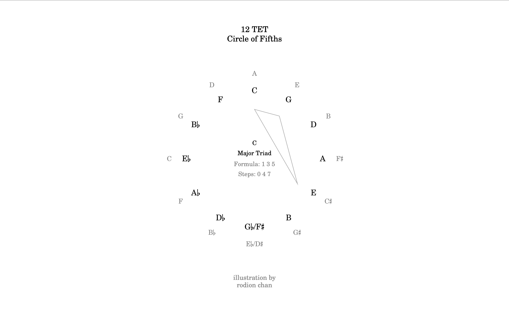
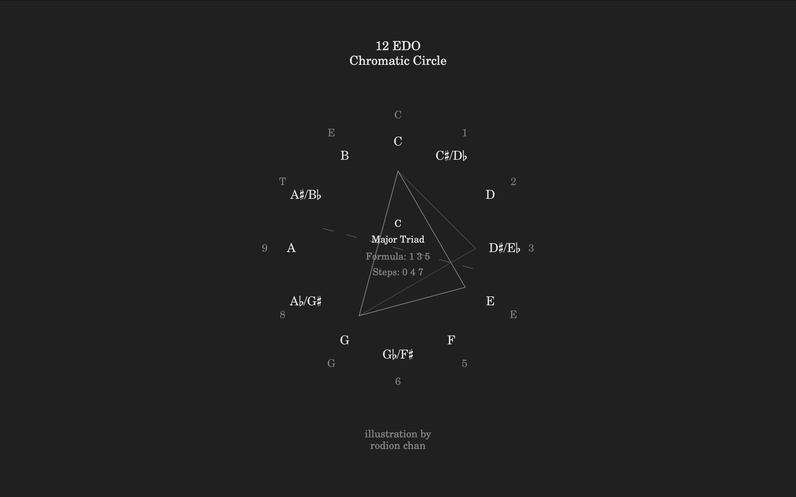
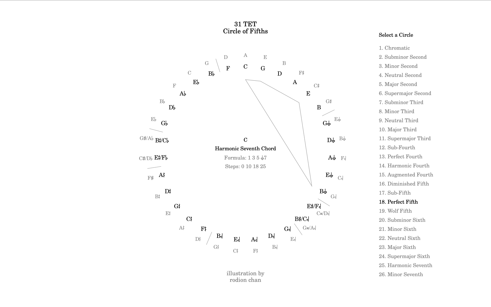
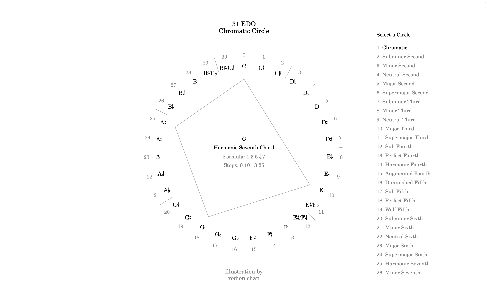

# Circle of Fifths Interactive

**Beta 1.0**  
An interactive tool for exploring notes, pitch-class relationships, and selected musical figures in 12-tone and 31-tone equal temperament.

Circle of Fifths Interactive is a standalone HTML application. It is designed primarily for desktop use and works without installation, a build step, or external runtime dependencies.

## Features

### Two tuning worlds

- **12 EDO (12-tone equal temperament):** explore the Circle of Fifths and the Chromatic Circle.
- **31 EDO (31-tone equal temperament):** explore 30 directed circle variants and switch between note-name and numeric outer-ring labels.

### Note selection and musical figures

- Select and deselect individual notes, or build a multi-note figure.
- Drag a selected note to another position to replace a note, merge selections, or remove the dragged note by releasing it in empty space.
- Move the selected figure through the current circle's pitch order.
- In 31 EDO, enter pitch-class IDs from 0 to 30 using the keyboard.

### Spelling and harmony

- In 12 EDO, switch between automatic chord-based spelling and manual enharmonic choices while keeping the same selected notes.
- In 12 EDO, manual mode allows available note spellings to be cycled; Shift-right-click restores the default spelling.
- Use the Harmony reference panel in the 12-tone world.
- View chord identification in both worlds. In 31 EDO, the `.` key shows or hides the chord-identification display.
- The application derives contextual note spellings from the selected musical material; automatic spelling does not change the underlying pitch identities.

### Symmetry and reflection

- Show or hide a symmetry axis.
- Preview an axis by holding Shift while moving the pointer over the circle; Shift-click to apply it.
- Shift-click an applied axis again to remove it.
- Swap the primary selection with its reflected selection.
- Rotate the selection and symmetry axis together, or rotate the axis independently.

### Audio

- Play the selected notes together as a chord, or stop playback.
- Enable or disable live note-hover sound preview. It is off by default.
- Adjust the volume and cycle through Sine, Triangle, Square, and Sawtooth waveforms.

### Interface and export

- Switch between light and dark themes.
- Use the Circle List to navigate the 31-EDO circle variants.
- Open the Export panel and download the current circle as an SVG or PDF file.
- Reassign the configurable letter shortcuts in the About screen and restore their defaults when needed.

## Screenshots

The screenshots below illustrate the main musical worlds and a representative reflection workflow. Store the PNG files in the repository's `screenshots/` folder using these filenames. GitHub renders these relative Markdown image paths automatically.

### 12 EDO

### 31 EDO

## Getting started

1. Download `index.html` from this repository (the file is the standalone Beta 1.0 application).
2. Open the file in a modern desktop web browser.
3. For the intended workspace, use the browser's full-screen mode.
4. Open **About** from the illustration credit at the bottom of the application to see the complete interaction guide and keyboard shortcuts.

The application is self-contained. Its scripts, styles, and font data are embedded in the HTML file; no package manager, local server, account, or external runtime library is required.

## Basic interaction

- **Click a note:** select it. Click it again to deselect it.
- **Click and drag a selected note:** move it. Drop it on an unselected note to replace that note, on a selected note to merge, or in empty space to remove the dragged note.
- **Click the title:** switch between the two 12-EDO circles, or open the Circle List in 31 EDO.
- **Shift-click the title:** switch between the 12-EDO and 31-EDO worlds.
- **Click the illustration credit:** open About. Shift-click the credit to open or close Export.
- **Right-click a note:** cycle its available spelling where supported. In 12 EDO this is available in Manual spelling mode. Shift-right-click restores the default spelling.
- **Hold Shift and move the pointer:** preview a symmetry axis. Shift-click applies or removes it.
- **Use the centre control:** play the selected notes or stop playback.

## Keyboard shortcuts

The following are the default shortcuts shown in the About screen. The configurable letter shortcuts can be reassigned there; use **Restore default shortcuts** to return to the defaults.

| Shortcut | Action |
|---|---|
| `S` | Switch between the 12-EDO circles, or toggle the Circle List in 31 EDO. |
| `Shift + S` | Switch between the 12-EDO and 31-EDO worlds. |
| `X` | Reverse the selected circle's direction in 31 EDO. |
| `Z` | Toggle outer-ring labels between numbers and note names. |
| `Shift + Z` | Restore each circle's default outer-ring labels. |
| `M` | Toggle the light and dark themes. |
| `P` | Toggle note-hover sound. |
| `O` | Cycle through Sine, Triangle, Square, and Sawtooth. |
| `I` | Toggle the symmetry axis. |
| `C` | Swap the primary and reflected selections. |
| `[ / ]` | Rotate the selected figure and symmetry axis together by one pitch position. Shift rotates by two positions. |
| `− / =` | Rotate the symmetry axis by one direction. Shift rotates it by two directions. |
| `A` | Toggle the Harmony reference panel in 12 EDO. |
| `R` | Toggle the Export panel. |
| `0–9, T, E` | Select or deselect pitch classes 0–11 in 12 EDO. |
| `0–30`, then `Space` or `Enter` | Enter and confirm a 31-EDO pitch ID. |
| `← / →` | Move the selected figure one position anticlockwise or clockwise. |
| `Shift + ← / →` | Move the selected figure by two positions. |
| `↓ / ↑` | Cycle through the 30 directed circle variants in 31 EDO. Holding the key repeats at up to one step every 0.5 seconds. |
| `Shift + ↓ / ↑` | Cycle through circle variants by two positions. |
| `.` | Toggle Automatic / Manual spelling in 12 EDO; show or hide chord identification in 31 EDO. |
| `Space` | Play the selected notes or stop playback. In 31 EDO, confirms a pending pitch ID. |
| `Backspace` | Cancel a pending 31-EDO pitch ID or clear the current selection. |
| `,` | Show or hide About. |
| `Escape` | Close About and return to the current circle. |

While About is open, functional shortcuts are disabled to prevent accidental actions. The theme shortcut remains available; Space can stop playback that is already active.

## Browser storage

Custom letter-shortcut assignments are saved in the browser's local storage when it is available. If browser storage is unavailable, the application remains usable for the current session, but custom assignments may not persist.

## Project files

- `index.html` — the standalone Beta 1.0 application.
- `README.md` — project overview and usage guide.
- `LICENSE` — MIT license for the original application code.
- `THIRD-PARTY-NOTICES.md` — attribution and license information for embedded fonts.
- `OFL-1.1-C059.txt` — full SIL OFL 1.1 license text for C059 Roman and its MicrotonalFont derivative.

## Licensing

The original application code is offered under the **MIT License**. The bundled Geist Mono font is licensed under SIL OFL 1.1. C059 Roman and the modified MicrotonalFont are also distributed under SIL OFL 1.1, using the documented OFL alternative for URW Core 35 Version 2.0. The fonts are not relicensed under MIT.

Read [`THIRD-PARTY-NOTICES.md`](./THIRD-PARTY-NOTICES.md) and [`OFL-1.1-C059.txt`](./OFL-1.1-C059.txt) for font attribution and license terms.

## Credits

Created by **rodion chan**.

The application includes third-party font software. See [`THIRD-PARTY-NOTICES.md`](./THIRD-PARTY-NOTICES.md) for attribution and license references.
